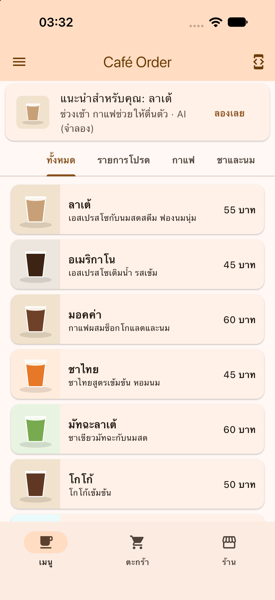

# Café Order

แอปสั่งเครื่องดื่มร้านกาแฟของคณะ — แอปประกอบการบรรยายรายวิชา ENGCE307 การพัฒนาโปรแกรมประยุกต์สำหรับอุปกรณ์เคลื่อนที่ (Flutter) มทร.ล้านนา

แอปนี้พัฒนาต่อยอดทีละสัปดาห์ ทุกสัปดาห์มีแท็ก Git (`w01`–`w08`, `w10`–`w16`) รายละเอียดว่าแต่ละสัปดาห์เพิ่มอะไรและโค้ดใดเป็นจุดสาธิตของหัวข้อบรรยายใด อยู่ใน [WEEKS.md](WEEKS.md)



## ความสามารถ

- เมนูแบบรายการ/กริด แยกหมวด รายการโปรด และการ์ด "แนะนำสำหรับคุณ" (AI จำลอง)
- ปรับแต่งเครื่องดื่ม (ขนาด ความหวาน ท็อปปิง ชื่อบนแก้ว) → ตะกร้า → สั่งซื้อ
- ติดตามสถานะคำสั่งซื้อแบบเรียลไทม์ และหน้าบาริสต้าเปลี่ยนสถานะ (Cloud Firestore)
- ประวัติคำสั่งซื้อและใบเสร็จในเครื่อง (SQLite + ไฟล์) รีวิวพร้อมภาพ
- หาสาขาที่ใกล้ที่สุดจากตำแหน่งของเครื่อง แต้มสะสม (โทเค็นใน secure storage)
- ธีมสว่าง/มืด ภาษาไทย/อังกฤษ รองรับโปรแกรมอ่านหน้าจอ จอแท็บเล็ตแบบสองบาน

## สถาปัตยกรรม

```
View (ui/<feature>/*_page.dart)
  │  context.watch / read (provider)
ViewModel (ui/<feature>/*_view_model.dart, ChangeNotifier)
  │
Repository (data/repositories/) ← Single Source of Truth, เป็นอินเทอร์เฟซ สลับ implementation ได้
  │
Service (data/services/): SQLite, shared_preferences, ไฟล์, REST (http), Firebase,
                          geolocator, image_picker, MethodChannel, secure storage, AI
```

- `lib/main.dart` คือ composition root: สร้าง Service → Repository แล้วส่งให้ `buildApp()` ใน `lib/app_dependencies.dart`
- `packages/cafe_core/` โมเดลและตรรกะ (Dart ล้วน) ใช้ร่วมกันทั้งแอปและเซิร์ฟเวอร์จำลอง
- `lib/router.dart` เส้นทางทั้งหมด (go_router) และ AuthGate (`redirect`)
- `lib/demos/` จุดสาธิตในชั้นเรียน เปิดจากปุ่มเมนูผู้พัฒนา

## การรัน (แท็ก w16)

ต้องมี Flutter 3.47 และ Firebase CLI (ใช้กับ Emulator เท่านั้น ไม่ต้องมีบัญชี Firebase)

```bash
flutter pub get
dart run tool/mock_server.dart                                   # เทอร์มินัล 1: REST API ที่ :8080
firebase emulators:start --project demo-cafe-order               # เทอร์มินัล 2: Auth :9199, Firestore :8180, UI :4100
flutter run                                                      # เทอร์มินัล 3
```

- บัญชีบาริสต้า: สมัครด้วยอีเมลที่ลงท้าย `@barista.test` แล้วเปิดเมนู "บาริสต้า" ใน Drawer
- เครื่องจริงในเครือข่ายเดียวกัน: `flutter run --dart-define=API_BASE_URL=http://<IP>:8080 --dart-define=EMULATOR_HOST=<IP>`

## การทดสอบ

```bash
flutter test                                        # Unit + Widget (ไม่ต้องมีเซิร์ฟเวอร์)
(cd packages/cafe_core && dart test)
flutter test integration_test/app_test.dart -d <เครื่องจำลอง>        # ทั้งแอป ใช้ Repository ปลอม
firebase emulators:exec --project demo-cafe-order "dart run tool/rules_check.dart"
```

`integration_test/emulator_test.dart` และ `integration_test/device_test.dart` ต้องเปิด Emulator/เซิร์ฟเวอร์จำลองก่อน (ดูคอมเมนต์หัวไฟล์)

## สาธิตในชั้นเรียน (สัปดาห์ 16: การนำเสนอและประเมิน)

1. เปิดแอป → สมัครบัญชีลูกค้า (AuthGate) → การ์ดแนะนำ → "ลองเลย"
2. ปรับแต่งลาเต้ L หวาน 50% → ใส่ตะกร้า (badge) → สั่งซื้อ → หน้าติดตามสถานะ
3. อีกเครื่องหนึ่ง (หรือ Emulator UI ที่ http://localhost:4100) ล็อกอินบาริสต้า → เปลี่ยนสถานะ → ลูกค้าเห็นทันทีและเครื่องสั่น
4. ร้าน → หาสาขาใกล้ฉัน (จำลองพิกัดของเครื่องจำลอง) → แต้มสะสม
5. ประวัติ → ใบเสร็จ → รีวิวพร้อมภาพ; ตั้งค่า → โหมดมืด/English
6. ประเมินการใช้งาน (Usability) ด้วยรายการตรวจด้านล่าง

### รายการตรวจการใช้งาน (ใช้ประเมินแอปของตนเองและของเพื่อน)

| ด้าน | คำถาม |
|---|---|
| ทำงานสำเร็จ | ผู้ใช้ใหม่สั่งเครื่องดื่มได้ภายใน 1 นาทีโดยไม่มีคนช่วยหรือไม่ |
| สถานะของระบบ | ทุกการรอ (โหลดเมนู ส่งคำสั่งซื้อ หาตำแหน่ง) มีตัวบอกสถานะหรือไม่ |
| ข้อผิดพลาด | ข้อความผิดพลาดบอกสาเหตุและทางแก้ (ลองอีกครั้ง/เปิดการตั้งค่า) หรือไม่ |
| การเข้าถึง | ใช้ VoiceOver/TalkBack และตัวอักษรขนาด 200% ได้หรือไม่ |
| ความเป็นส่วนตัว | ขอสิทธิ์เมื่อจำเป็นเท่านั้น และอธิบายเหตุผลหรือไม่ |
| AI | บอกผู้ใช้ว่าเป็นผลจาก AI พร้อมเหตุผล และแอปยังใช้ได้เมื่อ AI ล้มเหลวหรือไม่ |

## การสร้างไฟล์เผยแพร่ (สัปดาห์ 15)

```bash
cp android/key.properties.example android/key.properties    # แก้ค่าให้ชี้ keystore ของตนเอง (ห้าม commit)
flutter build apk --release --obfuscate --split-debug-info=build/symbols
flutter build appbundle --release                            # สำหรับ Google Play
```

แท็ก w16 ยังชี้ไป Firebase Emulator และเซิร์ฟเวอร์ HTTP ในเครื่อง ใช้สาธิตได้เท่านั้น การเผยแพร่จริงต้องมี API แบบ HTTPS และโปรเจกต์ Firebase จริง
